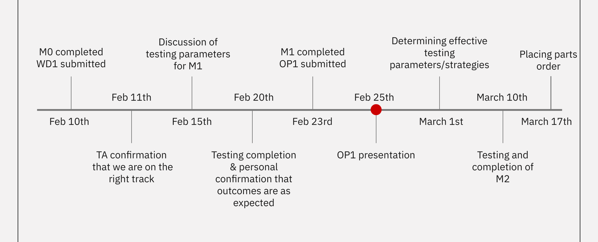
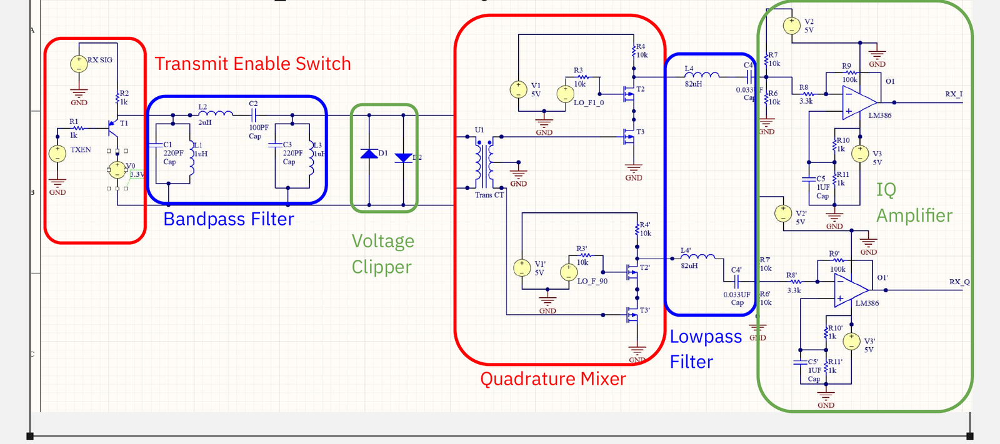
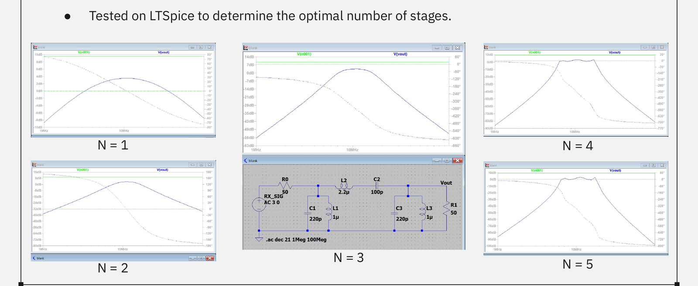
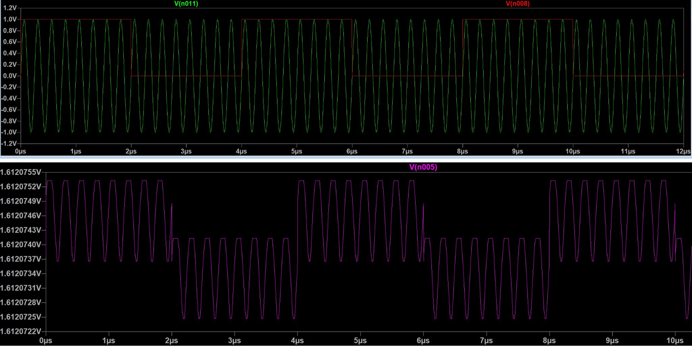
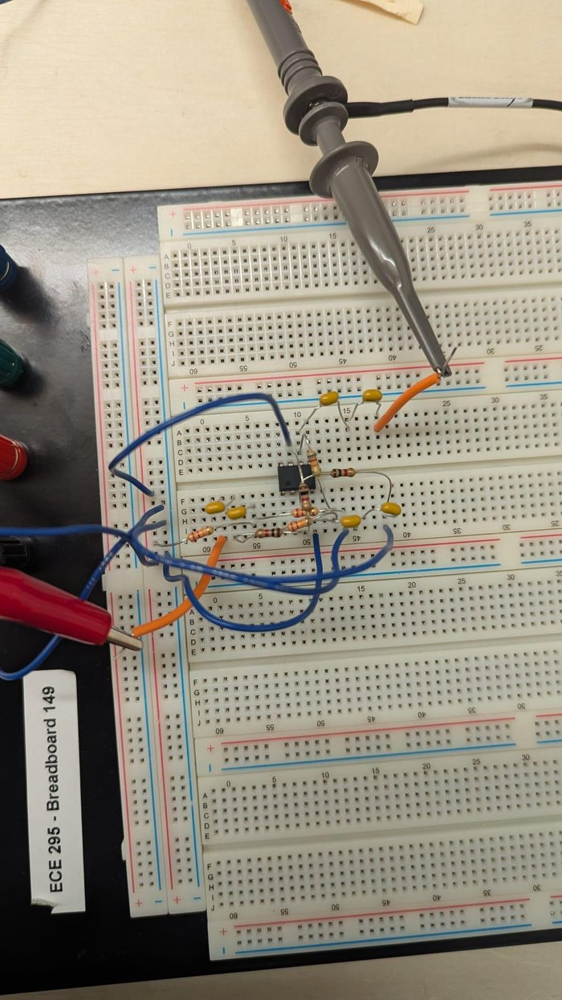
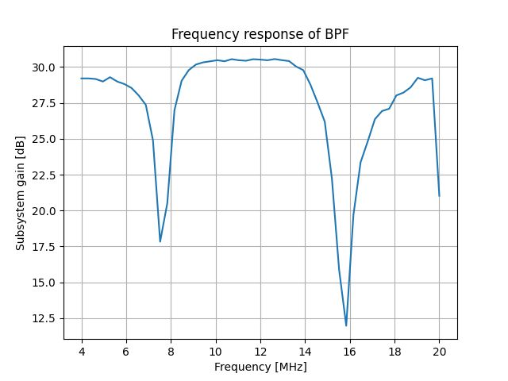
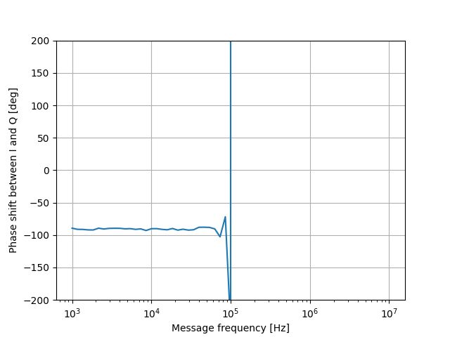
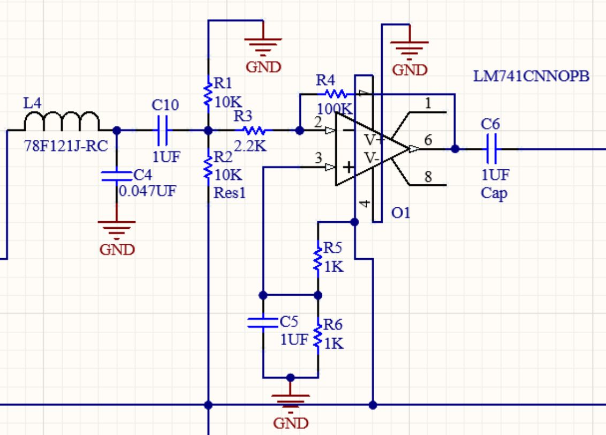

# SDR Receiver Subsystem (ECE 295)

Hardware design project for **ECE295: Hardware Design and Communication** at the University of Toronto (Winter 2025).

I led a team of three to design, build, and test **Subsystem A, the front end receiver** of a software-defined radio (SDR). This stage takes the signal from the antenna, filters out unwanted frequencies and noise, and prepares it for further digital processing.

**Team:** Naisha Shah (Team Lead), Abhusha Ghimire, Zara Munshi


## My role as Team Lead

The course had 10 major deadlines spread over the term (reports, technical milestones, presentations, PCB submissions), so a lot of my job was figuring out who was doing what each week and making sure we didn't fall behind. This also included taking on extra responsibility to ensure all team members' contributions were up to standard, and reviewing everyone's work before each submission. I was also the main spokesperson who was in charge of external communications, including contact with the Teaching Assistants for technical questions and demonstrations, as well as the Communications Instructors for written submissions and presentations. 

Design Proposal: 
Slides: [Proposal presentation, Feb 2025](docs/OP1_Proposal.pdf) · [Final design review, Apr 2025](docs/Final_Design_Review.pdf)

---

## What the subsystem does

The receiver takes the incoming RF signal from the RX switch, keeps only the band we care about, mixes it down to baseband as two signals 90° apart (I and Q), and amplifies them for the demodulator (Subsystem B). The local oscillator signals that drive the mixer come from Subsystem C.

```
RX_SIG → Enable Switch → Bandpass Filter → Voltage Clipper → Quadrature Mixer → Low-pass Filter → I/Q Amplifier → RX_I, RX_Q
                                                                  ↑
                                                       LO_0° / LO_90° (Subsystem C)
```

**Inputs:** RX_SIG, LO_F1_0, LO_F1_90, /TXEN, 3.3 V and 5 V power
**Outputs:** RX_I, RX_Q (90° apart, matched within 1 dB, never above 5 V)

---

## Stage 1: Planning

Everything had to meet the course's Interface Control Document (ICD), with a tight timeline and a strict budget. That pushed me toward designs that were simple, reliable, and cheap rather than clever. Here's how the term was laid out:

| Date | Milestone |
|---|---|
| Jan 24 | Written Document 0 |
| Feb 10 | Technical Milestone 0, Written Document 1 |
| Feb 11–15 | TA check-in on our direction, planned the testing parameters for M1 |
| Feb 24 | Technical Milestone 1, Oral Presentation 1 (design proposal) |
| Mar 10 | Technical Milestone 2 |
| Mar 16–17 | PCB submission, parts order |
| Apr 1 | Technical Milestone 3 |
| Apr 29–30 | Rehearsal pitch, final design pitch |



## Stage 2: Proposed design (February)

For the first oral presentation, we proposed a full schematic and justified each block:



| Block | What we chose | Why |
|---|---|---|
| Transmit enable switch | PNP BJT | Keeps the receiver off while the radio is transmitting, so the TX and RX paths don't interfere. A BJT was cheaper than a MOSFET, fine for simple logic, and its lower threshold made it more reliable with a pulsed control signal. |
| Bandpass filter | 3-stage LC filter, 8–16 MHz | I simulated N = 1 to 5 stages in LTspice. N = 3 was the best balance between sharp filtering and part count. |
| Voltage clipper | 1N4148 diodes | Clips the signal to ±0.7 V so the stages after it are protected |
| Quadrature mixer | Center-tapped transformer and PMOS switches | MOSFET switching is more robust and accurate than diode switching, and it avoids extra voltage drops |
| Low-pass filter | Single-stage LC, 96 kHz cutoff | Removes everything above the baseband after mixing |
| I/Q amplifier | LM386 | Low power, adjustable gain (20 to 200), and rail-to-rail output, so it can hit 30 dB and limit cleanly to 0–5 V |



Before building anything, we checked every requirement in simulation: the 8–16 MHz passband, ±0.7 V clipping, downconversion through the mixer, the 96 kHz low-pass cutoff, and 30 dB of gain (a 1 V input coming out at about 31.6 V with an ideal op amp, since 30 dB is a voltage gain of 10^(30/20) ≈ 31.6).



We also flagged the risks we expected going into integration: getting every subsystem working together on one radio, tight board space, and heat during testing.

## Stage 3: Breadboard prototyping

We built each stage on a breadboard and checked it before committing to a layout:

| Stage | Works? | Meets spec? |
|---|---|---|
| Bandpass filter | ✅ | Partly |
| Voltage clipper | ✅ | ✅ |
| Low-pass filter | ✅ | ❌ |
| I/Q amplifier | ✅ | ✅ |



## Stage 4: Design changes

Prototyping changed a few of the proposal's choices before anything went on a board:

- **Quadrature mixer:** we replaced the hand-built mixer (a center-tapped transformer driving PMOS switches) with off-the-shelf Mini-Circuits mixer modules (ADE-1+). That gave us a characterized, repeatable part instead of a circuit that was sensitive to how it was built.
- **I/Q amplifier:** we moved from the LM386 to an LM741-based op-amp stage


Here's the final schematic, with each stage marked:


## Stage 5: PCB design

I did the schematic capture and board layout in Altium Designer and submitted the board for fabrication in mid-March.


## Stage 6: Assembly

We soldered the board with solder paste and an iron, then mounted it on the radio motherboard.


## Stage 7: Final testing

I characterized each stage on the finished board with an oscilloscope, waveform generator, and bench power supply, using measurement scripts for the final checks.


| Bandpass filter | I/Q phase difference | Low-pass filter |
|---|---|---|
|  |  |  |

| Component | Requirement | Measured | Error | Pass? |
|---|---|---|---|---|
| Enable switch | 3.3 V high | 3.3 V | 0% | ✅ |
| Bandpass filter | 8–16 MHz | ~8–14.5 MHz | ~0% (low edge), ~9.4% (high edge) | ⚠️ |
| Voltage clipper | 0.7 V | 0.7 V | ~0% | ✅ |
| Quadrature mixer | −90° I/Q phase shift | ~−90° | ~0% | ✅ |
| Low-pass filter | 96 kHz cutoff | ~20 kHz | ~79.2% | ❌ |
| I/Q amplifier | >30 dB gain | >30 dB | 0% | ✅ |

Every stage worked, and four of the six met spec. The other two taught me the most.

---

## What went wrong and what I learned

**Low-pass filter cutoff (96 kHz expected, ~20 kHz measured).** This was the big one. During final testing the cutoff came in almost 80% low. I traced it to the layout: the low-pass filter sits right next to a high-pass filter, and once the two were cascaded, the loading between them dragged the cutoff down. We hadn't caught it earlier because we'd been testing each section on its own. The fix is simple: recalculate the component values for the cascaded circuit so the cutoff moves back up to 96 kHz.



> What I'd do differently: test stages together as soon as they connect, not just one by one.

**Bandpass filter upper edge (~14.5 MHz instead of 16 MHz).** A few of our parts had ±20% tolerance, which was enough to pull the upper cutoff down. Tighter-tolerance components would fix it.

> What I'd do differently: build component tolerance into the simulation from the start, or spend a bit more of the budget on better parts in the places where precision matters.

## Repository contents

```
docs/      Proposal and final design review slides (PDF)
images/    Schematics, simulations, PCB layout, the board, and scope captures
```

## Tools and skills

Altium Designer · LTspice · breadboard prototyping · PCB layout · SMD and through-hole soldering · oscilloscope / function generator measurements · RF filter design · BJT and MOSFET switching · op-amp circuits · technical presentation

## References

- *Flexible Radio Transceiver (FLRTRX) Interface Control Document*, ECE 295, University of Toronto, 2025.
- S. V. Hum, *Focused Design Labs 1 & 2: Subsystem A*, ECE 295, University of Toronto, 2025.
