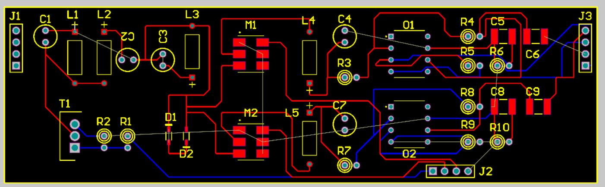
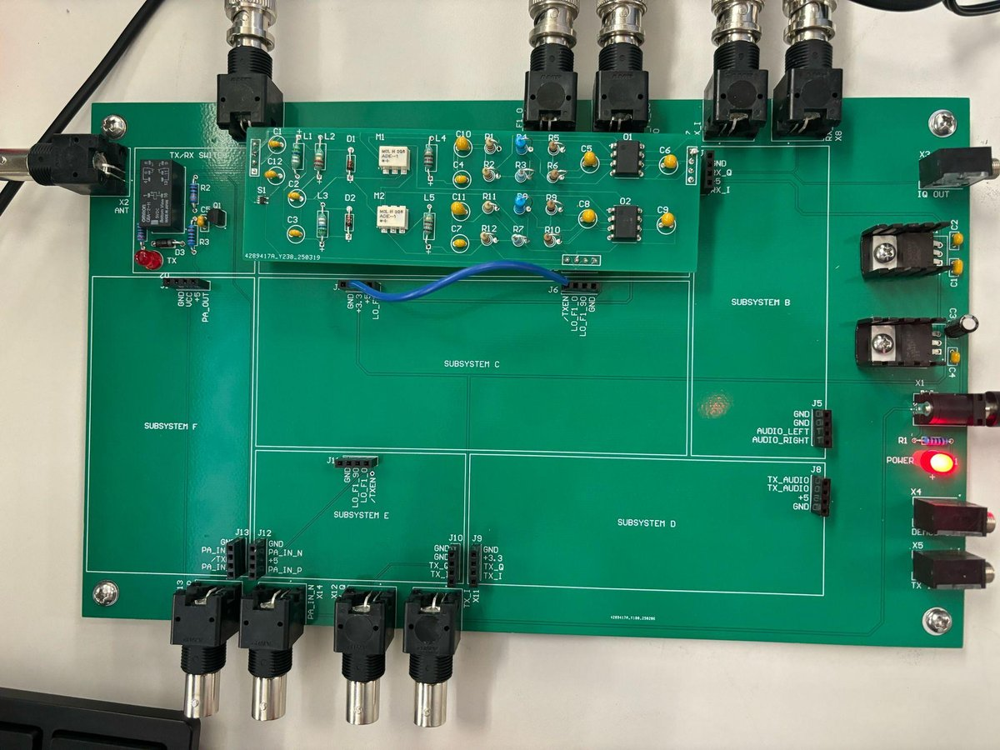
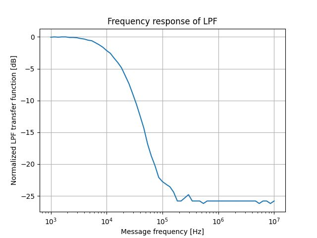

# SDR Receiver Subsystem (ECE 295)

During the winter semester of 2025, I led a team of three students to design, build, and test a **Receiver (RX) Subsystem** of a software-defined radio (SDR) for the design course ECE295.

**Team:** Naisha Shah (Team Lead), Abhusha Ghimire, Zara Munshi


## My role as Team Lead

The course had 10 major deadlines spread over the term (reports, technical milestones, presentations, PCB submissions), so a lot of my job was figuring out who was doing what each week and making sure we didn't fall behind. This also included taking on extra responsibility to ensure all team members' contributions were up to standard, and reviewing everyone's work before each submission. I was also the main spokesperson who was in charge of external communications, including contact with the Teaching Assistants for technical questions and demonstrations, as well as the Communications Instructors for written submissions and presentations. 

[Initial Design Spec Proposal, Feb 2025](docs/DesignProposal_Team5.pdf)

[Design Proposal Presentation, Feb 2025](docs/OP1_Proposal.pdf)

[Final Design Review, Apr 2025](docs/Final_Design_Review.pdf)

---

## What the subsystem does

The receiver takes the incoming RF signal from the RX switch, keeps only the band we care about by taking the desired frequency, mixes it down to baseband as two signals 90° apart (In-Phase and Quadrature), and amplifies them for the demodulator (Subsystem B). From then onwards, the signal undergoes further processing through the various other subsystems. The local oscillator signals that drive the mixer come from Subsystem C.

```
RX_SIG → Enable Switch → Bandpass Filter → Voltage Clipper → Quadrature Mixer → Low-pass Filter → I/Q Amplifier → RX_I, RX_Q
                                                                  ↑
                                                       LO_0° / LO_90° (Subsystem C)
```
---

## Planning

The major milestone layout of the term was as follows:

| Date | Milestone |
|---|---|
| Jan 24 | Written Document 0 |
| Feb 10 | Technical Milestone 0, Written Document 1 |
| Feb 24 | Technical Milestone M1, Oral Presentation 1 (design proposal) |
| Mar 10 | Technical Milestone M2 |
| Mar 16 | Final PCB submission, parts order |
| Apr 1 | Technical Milestone M3 |
| Apr 2–29 |PCB assembly and testing|
| Apr 30 |Final Design Review |
---

## Initial proposed design

Everything within our design had to meet the course's Interface Control Document (ICD), with a tight timeline and a strict budget. That pushed us toward designs that were simple, reliable, and cheap rather than overcomplicated and likely to induce error. 


## First major obstacle
For every major stage of the receiver, we went with whatever was cheapest and easiest to build that still met the spec. We used a basic transistor for the enable switch instead buying a more expensive component, stopped the bandpass filter at 3 stages because more would have added cost and board space for almost no improvement, and used simple op-amp circuits for the limiter and amplifier. That's also why we decided to try and build our own quadrature mixer instead of buying an integrated circuit (IC) like most other teams. However, after many proposed quad-mixer designs all not performing as expected, we weren't sure if the extra effort was yielding worthwhile results. Ultimately it turned out to be a lot harder than we expected, and we ended up buying one anyways to make sure we didn't fall behind on our time constraints 😞💔.

We replaced the hand-built mixer (a not-functional network of PMOS switches) with a cheap yet reliable off-the-shelf mixer IC (ADE-1+)


## Final design

After a numerous simulations and more minor tweaks, we landed on our final design for the receiver:


We created the schematic capture and PCB layout in Altium Designer and submitted the board for fabrication in mid-March.



## PCB Assembly

We soldered the board with a soldering iron for most components, as well as soldering paste and a heat gun for the couple surface-mounted components. After some basic continuity checks to ensure everything was connected properly, we then mounted our PCB on the radio motherboard.



## Testing procedure

We characterized each stage on the finished board with an oscilloscope, waveform generator, and power supply, using automated python scripts for the frequency sweeps.


| Bandpass filter | I/Q phase difference | Low-pass filter |
|---|---|---|
|  |  |  |

Ultimately, our board was mostly functional! The signal behaves generally as expected as it moves through the different components of our receiver. However, it wasn't perfect...

| Component | Requirement | Measured | Error | Pass? |
|---|---|---|---|---|
| Enable switch | 3.3 V high | 3.3 V | 0% | ✅ |
| Bandpass filter | 8–16 MHz | ~8–14.5 MHz | ~0% (low edge), ~9.4% (high edge) | ❌ |
| Voltage clipper | 0.7 V | 0.7 V | ~0% | ✅ |
| Quadrature mixer | −90° I/Q phase shift | ~−90° | ~0% | ✅ |
| Low-pass filter | 96 kHz cutoff | ~20 kHz | ~79.2% | ❌ |
| I/Q amplifier | >30 dB gain | >30 dB | 0% | ✅ |

While every stage worked for the most part, our bandpass filter and low-pass filter had some issues meeting the desired cutoff frequency. However, both of these filters had previously been shown to be working in our LTSpice simulations. However, one thing we hadn't considered during our simulations was the impact of the different modules on each other. We  had tested each part (bandpass filter, voltage clipper, low-pass filter, amplifier) separately. However, on the actual board, it's possible that the low-pass filter cascaded with an unforseen high-pass filter part of our IQ Amplifier design, and dragged the cutoff down. We hadn't caught it earlier because we'd been testing each section on its own. If this is indeed the cause of error, the fix should be to just recalculate the component values for the cascaded circuit so the cutoff moves back up to 96 kHz.

The bandpass filter upper cutoff was also slightly off, but not by a large amount. One detail I noticed after reviewing for potential causes of error was the tolerances of our components. A few of our parts, mainly the inductors, had ±20% tolerance. It's possible this tolerance was was enough to pull the upper cutoff down due to inaccurate values. Tighter-tolerance components should fix this issue.

**Major Takeaways**
- Test parts of neighbouring stages together to identify how they might impact each other
- Build component tolerance into the simulation from the start, or spend a bit more of the budget on better parts

## Conclusion

Looking back, this was one of the most hands-on and rewarding projects I've done so far. It was the first time I took a circuit from an idea on paper all the way to a physical board I could hold, plug into a real radio, and measure. Seeing a signal actually make it through our receiver on the oscilloscope after months of simulations and redesigns was extremely satisfying, and made me feel like all my hard work was worth it.

The part I didn't expect to learn the most from was managing the team itself. Three people with different schedules, working styles, and opinions on how the design should go meant we didn't always agree, and there were times when things got tense. Honestly, it wasn't always easy. As team lead I had to step in, hear everyone out, and steer us back toward a decision we could all commit to, even when that meant not everyone was happy with the outcome. It taught me a lot about leadership in general, and how working on a team almost never goes exactly as planned. No matter how many contingency plans you lay out in the beginning, some unexpected situation is going to pop up eventually, and knowing how to deal with it on the fly is one of the best skills to have.

Getting a working board out of all of it, the mixer struggles, the disagreements, and the late nights, made the final result feel that much more earned. I'm really grateful to my team, my TA, CI, as well as professor Sean Hum for putting together such an engaging design course 😁
