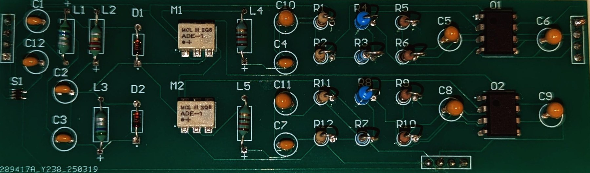
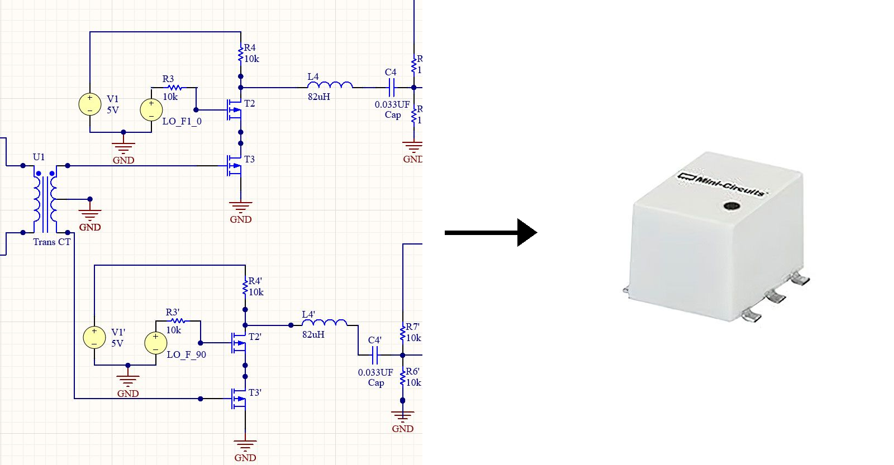
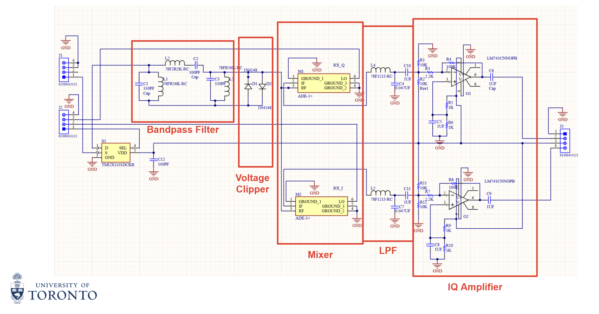
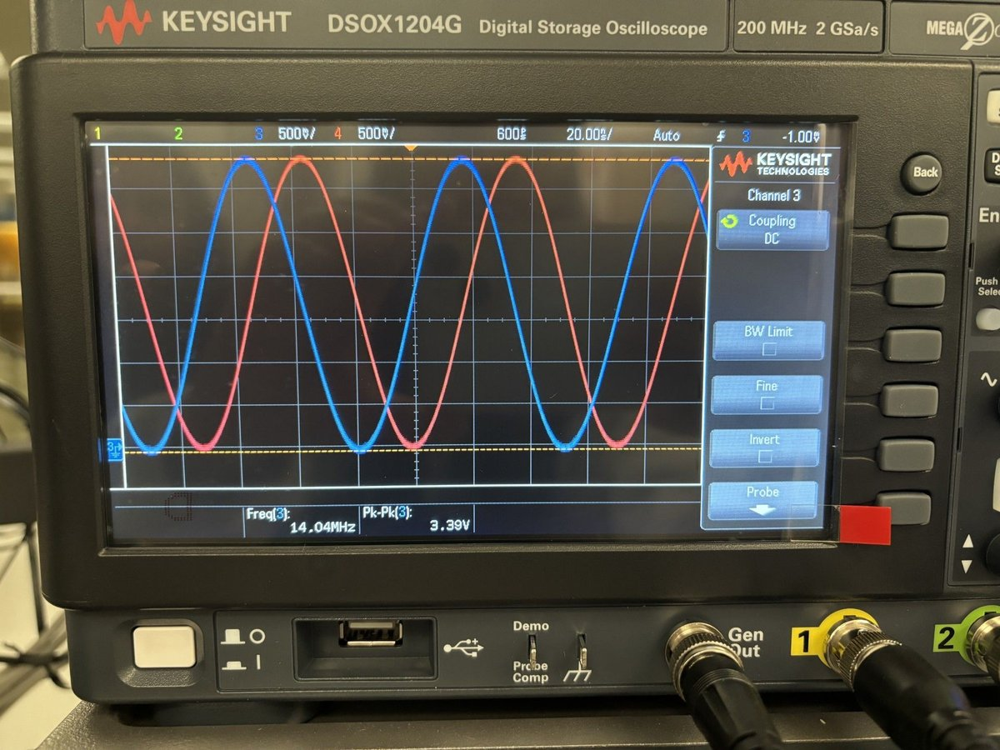

# SDR Receiver Subsystem (ECE 295)

During the winter semester of 2025, I led a team of three students to design, build, and test a **Receiver (RX) Subsystem** of a software-defined radio (SDR) for the design course ECE295.

**Team:** Naisha Shah (Team Lead), Abhusha Ghimire, Zara Munshi



## My role as Team Lead

The course had 10 major deadlines spread over the term (reports, technical milestones, presentations, PCB submissions), so a lot of my job was figuring out who was doing what each week and making sure we didn't fall behind. This also included taking on extra responsibility to ensure all team members' contributions were up to standard, and reviewing everyone's work before each submission. I was also the main spokesperson who was in charge of external communications, including contact with the Teaching Assistants for technical questions and demonstrations, as well as the Communications Instructors for written submissions and presentations. 

[Initial Design Spec Proposal, Feb 2025](docs/DesignProposal_Team5.pdf)

[Design Proposal Presentation, Feb 2025](docs/OP1_Proposal.pdf) · [Final Design Review, Apr 2025](docs/Final_Design_Review.pdf)

---

## What the subsystem does

The receiver takes the incoming RF signal from the RX switch, keeps only the band we care about by taking the desired frequency, mixes it down to baseband as two signals 90° apart (In-Phase and Quadrature), and amplifies them for the demodulator (Subsystem B). From then onwards, the signal undergoes further processing through the various other subsystems. The local oscillator signals that drive the mixer come from Subsystem C.

```
RX_SIG → Enable Switch → Bandpass Filter → Voltage Clipper → Quadrature Mixer → Low-pass Filter → I/Q Amplifier → RX_I, RX_Q
                                                                  ↑
                                                       LO_0° / LO_90° (Subsystem C)
```
---

## Planning

The major milestone layout of the term was as follows:

| Date | Milestone |
|---|---|
| Jan 24 | Written Document 0 |
| Feb 10 | Technical Milestone 0, Written Document 1 |
| Feb 24 | Technical Milestone M1, Oral Presentation 1 (design proposal) |
| Mar 10 | Technical Milestone M2 |
| Mar 16 | Final PCB submission, parts order |
| Apr 1 | Technical Milestone M3 |
| Apr 2–29 |PCB assembly and testing|
| Apr 30 |Final Design Review |
---

## Initial proposed design

Everything within our design had to meet the course's Interface Control Document (ICD), with a tight timeline and a strict budget. That pushed us toward designs that were simple, reliable, and cheap rather than overcomplicated and likely to induce error. 


## First major obstacle
For every major stage of the receiver, we went with whatever was cheapest and easiest to build that still met the spec. We used a basic transistor for the enable switch instead buying a more expensive component, stopped the bandpass filter at 3 stages because more would have added cost and board space for almost no improvement, and used simple op-amp circuits for the limiter and amplifier. That's also why we decided to try and build our own quadrature mixer instead of buying an integrated circuit (IC) like most other teams. However, after many proposed quad-mixer designs all not performing as expected, we weren't sure if the extra effort was yielding worthwhile results. Ultimately it turned out to be a lot harder than we expected, and we ended up buying one anyways to make sure we didn't fall behind on our time constraints 😞💔.

We replaced the hand-built mixer (a not-functional network of PMOS switches) with a cheap yet reliable off-the-shelf mixer IC (ADE-1+)




## Final design

After a numerous simulations and more minor tweaks, we landed on our final design for the receiver:



We created the schematic capture and PCB layout in Altium Designer and submitted the board for fabrication in mid-March.


## Stage 6: Assembly

We soldered the board with solder paste and an iron, then mounted it on the radio motherboard.


## Stage 7: Final testing

I characterized each stage on the finished board with an oscilloscope, waveform generator, and bench power supply, using measurement scripts for the final checks.



| Bandpass filter | I/Q phase difference | Low-pass filter |
|---|---|---|
|  |  |  |

| Component | Requirement | Measured | Error | Pass? |
|---|---|---|---|---|
| Enable switch | 3.3 V high | 3.3 V | 0% | ✅ |
| Bandpass filter | 8–16 MHz | ~8–14.5 MHz | ~0% (low edge), ~9.4% (high edge) | ⚠️ |
| Voltage clipper | 0.7 V | 0.7 V | ~0% | ✅ |
| Quadrature mixer | −90° I/Q phase shift | ~−90° | ~0% | ✅ |
| Low-pass filter | 96 kHz cutoff | ~20 kHz | ~79.2% | ❌ |
| I/Q amplifier | >30 dB gain | >30 dB | 0% | ✅ |

Every stage worked, and four of the six met spec. The other two taught me the most.

---

## What went wrong and what I learned

**Low-pass filter cutoff (96 kHz expected, ~20 kHz measured).** This was the big one. During final testing the cutoff came in almost 80% low. I traced it to the layout: the low-pass filter sits right next to a high-pass filter, and once the two were cascaded, the loading between them dragged the cutoff down. We hadn't caught it earlier because we'd been testing each section on its own. The fix is simple: recalculate the component values for the cascaded circuit so the cutoff moves back up to 96 kHz.


> What I'd do differently: test stages together as soon as they connect, not just one by one.

**Bandpass filter upper edge (~14.5 MHz instead of 16 MHz).** A few of our parts had ±20% tolerance, which was enough to pull the upper cutoff down. Tighter-tolerance components would fix it.

> What I'd do differently: build component tolerance into the simulation from the start, or spend a bit more of the budget on better parts in the places where precision matters.

## Repository contents

```
docs/      Proposal and final design review slides (PDF)
images/    Schematics, simulations, PCB layout, the board, and scope captures
```

## Tools and skills

Altium Designer · LTspice · breadboard prototyping · PCB layout · SMD and through-hole soldering · oscilloscope / function generator measurements · RF filter design · BJT and MOSFET switching · op-amp circuits · technical presentation

## References

- *Flexible Radio Transceiver (FLRTRX) Interface Control Document*, ECE 295, University of Toronto, 2025.
- S. V. Hum, *Focused Design Labs 1 & 2: Subsystem A*, ECE 295, University of Toronto, 2025.
